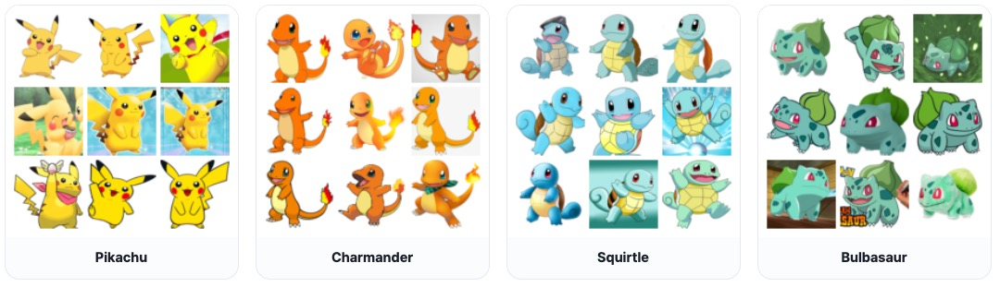

---
hide:
  - navigation
---

# AIC313/CS378: Introduction to Generative Models

<h3><b>
<a href="http://mhsung.github.io/" target="_blank">Minhyuk Sung</a>, <a href="https://www.kaist.ac.kr/" target="_blank">KAIST</a>, Fall 2026
</b></h3>


## FastGen Challenge

^^**Mid-Term Evaluation Submission Due (Optional)**^^: ==October 31 (Saturday), 23:59 KST==  
^^**Final Submission Due**^^: ==November 7 (Saturday), 23:59 KST==  
^^**Where to submit**^^: ==KLMS==  


[Introduction Slides]({{links.fastgen_slides}}){:target="_blank" .md-button}
[Base Code]({{links.fastgen_repo}}){:target="_blank" .md-button}


### Goal
**TL;DR: Your goal is to generate Pokemon images FAST!**

In this challenge, you will implement and train your own **image generation models**. The goal is to achieve **high-quality image generation with only a few sampling steps**. You are encouraged to explore advanced techniques for few-step generation.


### What to Do
We provide the **model skeleton code** and the **evaluation code**. Your goal is to **design and implement your own image generation models**, including:

- **Few-step generation framework**: Use an existing framework or design your own generative model.
- **Model architecture**: Design an effective model backbone.
- **Other training details**: Choose data augmentation, learning rate, optimizer, and other training settings.

Specifically, your tasks are as follows:

1. **Implementing Your Own Models**
    - You may modify the provided code (`model.py`) and add new files if necessary.
    - You must implement the **following two models** used by the evaluation code:
        - `class ModelOneNFE(Model)`: Model for 1-NFE generation
        - `class ModelFewNFE(Model)`: Model for few-NFE generation
    - **DO NOT** modify the base class `class Model(nn.Module)`.

2. **Training the Models**
    - You may freely use your own training pipeline, including model training and dataset preparation.
    - You may train the two models (`ModelOneNFE` and `ModelFewNFE`) separately or let them share weights. You may also train auxiliary networks (e.g., a teacher model for distillation) from scratch, as long as they are not used at sampling time.
    - You can design your own model, but there are some restrictions:
        - Each learned model used during training or sampling must individually have no more than **100M parameters**.
            - This limit applies to all learned models, including teacher models used only during training.
            - The 100M limit is applied **separately to each model**. Parameter counts of different models (e.g., a teacher and a student) are **not summed together**.
            - For each model, the parameter count refers to the **entire model framework, including all learnable components**, not only the main backbone.
            - For example:
                - Teacher ≤ 100M / Student ≤ 100M → **Allowed**
                - Teacher > 100M / Student ≤ 100M → **Not Allowed**
                - Teacher ≤ 100M / Student > 100M → **Not Allowed**
        - The peak VRAM while training the model must be less than **20 GB** (the size of the vGPU provided through KCLOUD).
        - The use of any pretrained model is **prohibited**. Everything must be trained from scratch on the provided training split. (The Inception network inside the provided FID evaluation code is the only exception.)

3. **Sampling Images**
    - You should implement the `Model.sample()` method inside `model.py` for each model within the pre-defined NFE limit.
        - `ModelOneNFE.sample()` must use exactly **1 NFE**.
        - `ModelFewNFE.sample()` may use **any number of NFEs up to 4** (i.e., 2, 3, or 4).
    - **NFE**: Number of Function Evaluations (= Sampling Steps).
        - Any execution of **any part of the trained model backbone** counts as 1 NFE.
        - Any other learned network evaluated during sampling (e.g., a refiner or decoder) also counts as 1 NFE per evaluation, and its parameters count toward the 100M budget.
    - Check out the [Recommended Readings](#recommended-readings) section, but you are _not_ limited to implementing one of the algorithms introduced in those papers; they are provided only as references.


**==Important Notes==**

^^PLEASE READ THE FOLLOWING CAREFULLY! Any violation of the rules or failure to properly cite existing code, models, or papers used in the project in your write-up will result in a zero score.^^

**What you ==CANNOT== do**

- **DO NOT** use any pretrained model. You must train both submitted models from scratch.  
- **DO NOT** modify `class Model(nn.Module)` in `model.py`. Its checkpoint-loading and parameter-counting utilities are fixed for consistent evaluation.  
- **DO NOT** modify the provided files marked as `DO NOT modify` in the [Codebase Structure](#codebase-structure) (`dataset.py`, `download_dataset.py`, `evaluate.py`, `src/utils.py`, and the data split files). These are kept fixed to ensure consistent evaluation across all submissions.  
- **DO NOT** use the validation split for training. Only the images listed in `train_split.txt` may be used for training, distillation, or hyper-parameter selection; the validation split is the FID reference set. TAs may inspect your training code and data pipeline to verify this.  
- **DO NOT** exceed **100M parameters** per model. `ModelOneNFE` and `ModelFewNFE` each get their own 100M budget, counted over every module registered on the model as loaded for sampling (frozen parameters included, buffers excluded). A model above the limit is **not evaluated** and scores zero for that NFE mode; the other mode is scored independently.  
- **DO NOT** exceed **20 GB of peak training VRAM**. Each model must train within a single 20 GB GPU, matching the NVIDIA A100 vGPU provided for this course. Measure with `torch.cuda.max_memory_allocated()`.  
- **DO NOT** rely on libraries installed manually. Your code must run in the TA environment using only the provided dependencies. If you need to use an additional package, you must first ask for approval in the #question channel on Slack and may use it only after it has been approved.

**What you ==CAN== do**

- **Modify `model.py`**: implement `ModelOneNFE`, `ModelFewNFE`, their architectures, objectives, and `sample()` methods.  
- **Add your own training script** with optimizers, LR schedulers, model-specific arguments, and checkpoint saving. The base code ships no training script.  
- **Create new files** required by your models or training procedure, and include every one of them in the submission.  
- **Use open-source implementations**, as long as they are **clearly mentioned and cited** in your write-up.  


### Dataset

You are required to use the [Pokemon Generation One](https://www.kaggle.com/datasets/bhawks/pokemon-generation-one-22k){:target="_blank"} image dataset for training and evaluation. It consists of 20,099 images across 151 Pokemon categories.

{ width=80% }

- We will provide the **training / validation split** for the dataset.
    - Training set: 17,079 images
    - Validation set: 151 categories × 20 = 3,020 images
- You are only allowed to use the **training split** for training your model. The **validation split** will be used for the evaluation.
- We use **64×64** down-sampled images for computation efficiency.

**You do not need to download the dataset yourself.** The base code includes a script (`download_dataset.py`) that automatically downloads the dataset.


### Codebase Structure

```
AIC313-Project-FastGen/
├── model.py                      # NFE-specific model classes (students SHOULD modify subclasses)
├── dataset.py                    # Pokemon dataset and DataLoader API (provided, DO NOT modify)
├── download_dataset.py           # Kaggle dataset download utility (provided, DO NOT modify)
├── evaluate.py                   # Sample generation and FID evaluation (provided, DO NOT modify)
├── src/
│   ├── __init__.py
│   └── utils.py                  # Parameter counting utilities (provided, DO NOT modify)
└── data/
    └── pokemon-generation-one-22k/
        ├── train_split.txt       # Fixed training split (provided, DO NOT modify)
        ├── val_split.txt         # Fixed validation split (provided, DO NOT modify)
        └── category_to_id.json   # Fixed category-to-ID mapping (provided, DO NOT modify)
```

- **DO NOT modify**: Files that must be kept as-is (for fair comparison).
- **SHOULD modify**: Main files for implementing your solution (`model.py`).
- You are also free to add your own files and codes. Note that the base code does **not** include a training script, so you should write your own (e.g., `train.py`).
- Use the TA-provided `requirements.txt` as the reference for the TAs' evaluation environment. If your code needs additional packages, list them in the `requirements.txt` of your submission.

Further details are provided in the `README.md` of the [base code]({{links.fastgen_repo}}){:target="_blank"}.


### Evaluation

This is a **team-based challenge**. The performance of your image generative models will be evaluated quantitatively using [Fréchet Inception Distance (FID)](https://en.wikipedia.org/wiki/Fr%C3%A9chet_inception_distance){:target="_blank"} scores at **NFE = 1** and **Few-NFE (2–4)**. The **validation split** will be used as the reference set for FID.

**Grading policy update (November 5):** The FID between the training and validation splits is **20.82**. Given this intrinsic gap, an FID around **22** already represents sufficiently strong performance. The updated policy is intended to encourage interesting ideas, meaningful experiments, and clear analysis rather than extensive automated optimization for very small improvements in FID.

- You may compute FID yourself, but **TA-measured scores are official**.
- TAs will run your code **as-is** in their environment. Submissions that fail to run are scored as zero for the corresponding metric.
- Mid-term evaluation results will be published on the leaderboard.

**The FastGen Challenge accounts for 15% of the overall course grade.** The final evaluation uses a **fixed target FID of 22**, rather than the best FID achieved by any team. The base score is up to **7 points for one-NFE** and **7 points for few-NFE**, for a total of **14 points before bonus credit**. For each NFE setting, points are assigned as follows:

$$
\text{Score} = \min\left(7,\; \max\left(\frac{\text{TA's FID} - \text{Your FID}}{\text{TA's FID} - 22} \times 3.5 + 3.5,\; 0\right)\right)
$$

- An FID equal to the TA baseline earns **3.5 points** for that setting.
- An FID of **22 or lower** earns the full **7 base points** for that setting. Further FID improvements do not increase the score.

**TAs' reference FID scores** (the baseline in the formula above):

| Setting | TAs' FID |
| --- | --- |
| 1-NFE | **39.15** |
| Few-NFE (2–4) | **30.90** |

**Mid-term evaluation bonus**

For each NFE setting (**NFE = 1** and **Few-NFE (2–4)**), all teams that achieve an **FID below 22** receive **+0.25 bonus points**, for a maximum of **+0.5 bonus points** in total. This bonus does not depend on leaderboard rank.

**Final evaluation bonus**

There is **no bonus credit based solely on FID** in the final evaluation. Instead, TAs may select a small number of outstanding reports based on:

- Particularly interesting or creative approaches; and/or
- Excellent summaries and analyses of the methods and experiments.

Selected teams may receive bonus credit if they agree to share their reports with the rest of the class. **No presentation is required**, including for top-performing teams.


### Mid-Term Evaluation Submission (Optional)
The purpose of the mid-term evaluation is to provide feedback on your team's progress. **Participation is optional**. All teams that achieve an **FID below 22** receive **+0.25 bonus points per NFE setting**, for a maximum of **+0.5 bonus points** toward the final grade.

- **Due**: ==October 31 (Saturday), 23:59 KST== (one week before the final submission)
- **What to submit**
    1. **Self-contained source code** 
        - Your submission must include the complete codebase.
        - TAs will run your code in their environment with no changes.
    2. **Model checkpoints**  
        - Checkpoint path: `./checkpoints/one_nfe.ckpt` and `./checkpoints/few_nfe.ckpt`
        - ^^TAs will load them from these paths. Different paths will be FAILED.^^
        - If your model needs any configuration files to be loaded (e.g., architecture hyperparameters), include them in the submission and make sure `model.py` reads them without any manual step.
- **Evaluation**
    - The FID results will be published on the leaderboard.
    - We will provide the TAs' FID scores as a baseline.
    - Each NFE setting with an **FID below 22** earns **+0.25 bonus points**, up to **+0.5 bonus points** in total, regardless of rank.

**Example of Mid-Term Submission**

```
team_{team-id:0>2}/           # e.g. team_02
├── model.py                  # ModelOneNFE, ModelFewNFE, and Model
├── dataset.py                # Provided dataset/DataLoader interface
├── download_dataset.py       # Provided dataset downloader
├── evaluate.py               # Provided evaluation entry point
├── src/
│   ├── __init__.py
│   └── utils.py              # Provided parameter-counting utilities
├── requirements.txt
├── checkpoints/
│   ├── one_nfe.ckpt          # REQUIRED
│   └── few_nfe.ckpt          # REQUIRED
└── <all additional files>    # Include every file you implemented (e.g., your training script)
```


### Final Submission
- **Due**: ==November 7 (Saturday), 23:59 KST==
- **What to submit**:
    1. **Self-contained source code** (same as the mid-term evaluation submission)
    2. **Model checkpoints** (same as the mid-term evaluation submission)
    3. **Write-up (up to 4 pages)**
        - No template provided.  
        - Maximum of **four A4 pages**, excluding references. Shorter reports are welcome, provided they include all required components.
        - All of the following must be included:
            - **Technical details**: A description of the technical details of your one-step and few-step generation implementation.
            - **Training details**: Training logs (e.g., training loss curves), and total training time.
            - **Qualitative evidence**: 8 sample images from the training phases.  
            - **Citations**: All external code and papers used must be properly cited.
        - ^^Missing any of these items will result in a penalty.^^
        - ^^If the write-up exceeds four pages, any content beyond the fourth page will be ignored, which may lead to missing required items.^^
- **Bonus**: TAs may select outstanding reports for bonus credit based on creativity and/or the quality of the summary and analysis, provided the teams agree to share their reports with the class (see [Evaluation](#evaluation)). **No presentation is required.**


### Self-Evaluation Checklist
Before submitting, please check the following:

- [ ] Use the TA-provided `requirements.txt` to check compatibility.
- [ ] Each model has fewer than 100M parameters (check with `src/utils.py`).
- [ ] Code runs end-to-end (Train → Sample → Evaluate) without errors.
- [ ] Both checkpoint paths are correct (`./checkpoints/one_nfe.ckpt`, `./checkpoints/few_nfe.ckpt`).
- [ ] Citations are ready: all external code/papers are cited in the final write-up.


### Grading
^^**There is no late day. Submit on time.**^^  
**Late submission**: ==Zero score==.  
**Missing any required item in the final submission (code, checkpoints, write-up)**: ==Zero score==.  
**Missing items in the write-up**: ==10% penalty per missing item==.  


### Recommended Readings
[1]  [Kingma and Welling, Auto-Encoding Variational Bayes, ICLR 2014.](https://arxiv.org/abs/1312.6114){:target="_blank"}  
[2]  [Dinh et al., NICE: Non-linear Independent Components Estimation, 2015.](https://arxiv.org/abs/1410.8516){:target="_blank"}  
[3]  [Goodfellow et al., Generative Adversarial Nets, NeurIPS 2014.](https://arxiv.org/abs/1406.2661){:target="_blank"}  
[4]  [Ho et al., Denoising Diffusion Probabilistic Models, NeurIPS 2020.](https://arxiv.org/abs/2006.11239){:target="_blank"}  
[5]  [Lipman et al., Flow Matching for Generative Modeling, ICLR 2023.](https://arxiv.org/abs/2210.02747){:target="_blank"}  
[6]  [Liu et al., Flow Straight and Fast: Learning to Generate and Transfer Data with Rectified Flow, ICLR 2023.](https://arxiv.org/abs/2209.03003){:target="_blank"}  
[7]  [Salimans and Ho, Progressive Distillation for Fast Sampling of Diffusion Models, ICLR 2022.](https://arxiv.org/abs/2202.00512){:target="_blank"}  
[8]  [Song et al., Consistency Models, ICML 2023.](https://arxiv.org/abs/2303.01469){:target="_blank"}  
[9]  [Kim et al., Consistency Trajectory Models: Learning Probability Flow ODE Trajectory of Diffusion, ICLR 2024.](https://arxiv.org/abs/2310.02279){:target="_blank"}  
[10] [Yin et al., One-step Diffusion with Distribution Matching Distillation, CVPR 2024.](https://arxiv.org/abs/2311.18828){:target="_blank"}  
[11] [Frans et al., One Step Diffusion via Shortcut Models, ICLR 2025.](https://arxiv.org/abs/2410.12557){:target="_blank"}  
[12] [Tong et al., Learning to Discretize Denoising Diffusion ODEs, ICLR 2025.](https://arxiv.org/abs/2405.15506){:target="_blank"}  
[13] [Min et al., BézierFlow: Learning Bézier Stochastic Interpolant Schedulers for Few-Step Generation, ICLR 2026.](https://arxiv.org/abs/2512.13255){:target="_blank"}  

<br />

[Back to top](#)
<br />

