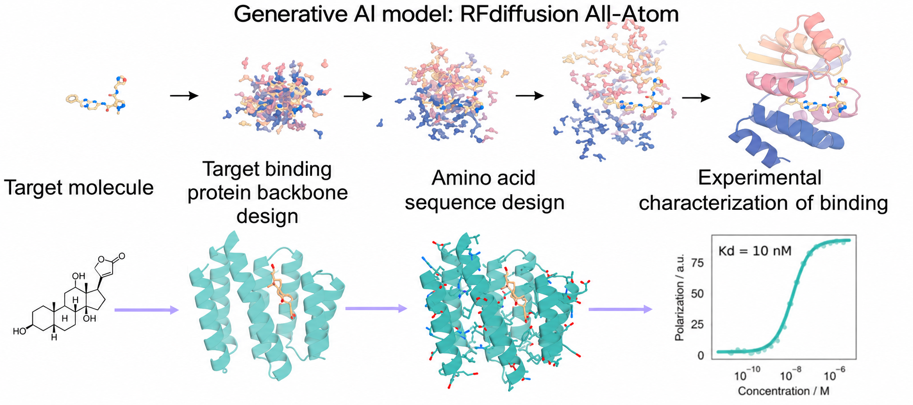

---
hide:
  - navigation
  - toc
---

# [Gyu Rie Lee](https://sites.google.com/view/aipdlab/home/people/pi){:target="_blank"}
## Designing novel proteins with generative models
### Assistant Professor, Department of Biological Sciences, KAIST November 30, 2026 (Mon), 10:30 a.m. KST Online (Zoom).

### <b>Guest Lecture at [AIC313/CS378: Introduction to Generative Models](../){:target="_blank"} [Minhyuk Sung](http://mhsung.github.io/){:target="_blank"}, [KAIST](https://www.kaist.ac.kr/){:target="_blank"}, Fall 2026</b>

 
[Zoom Link]({{links.zoom}}){:target="_blank" .md-button}
[Google Calendar Link](https://calendar.google.com/calendar/event?action=TEMPLATE&tmeid=N2I2Y3RwdTYwdjNidTdpbXFsbGxlbHVsbGogamhvMGR0bDBwczVjaWl2ZmxqOXJ0NmU0cWtAZw&tmsrc=jho0dtl0ps5ciivflj9rt6e4qk%40group.calendar.google.com){:target="_blank" .md-button}

<!--
[Recording]({{links.guest_rec1}}){:target="_blank" .md-button}
-->

 

{ width=85% }[^1]
{: style="text-align: center;" }

[^1]: Image from [https://sites.google.com/view/aipdlab/home/our-science](https://sites.google.com/view/aipdlab/home/our-science){:target="_blank"}.  

### **Abstract**
Recent breakthroughs in AI-based protein structural biology have transformed protein structure prediction and protein design. However, design challenges that require atomic-level accuracy and high-resolution modeling, such as small-molecule binding protein design and enzyme design, remain challenging. To address these challenges, we used RFdiffusion3 to generate proteins conditioned on chemical groups or active sites. We also developed LigandMPNN to generate sequences conditioned on protein-bound small-molecule coordinates. By combining these methods, we designed de novo binders for eight distinct small-molecule targets and chemically modified peptides. The binders were readily expressed in E. coli and exhibited binding affinities ranging from the nanomolar to low-micromolar range. Protein-ligand co-crystal structures validated the designs, showing close agreement between the experimental structures and the computational models. Building on this success in designing interactions between proteins and chemical groups, we are now extending our methods toward allosteric sensor design, de novo enzyme design, protein–RNA interface design, and binder design for recognizing chemical modifications such as glycosylation and methylation.

### **Bio**
Gyu Rie Lee is an Assistant Professor in the Department of Biological Sciences at KAIST, where she leads research on AI-driven de novo protein design. She received her Ph.D. in Physical Chemistry from Seoul National University, developing computational methods for protein structure refinement and biomolecular interaction modeling and participating in the community-wide CASP structure prediction assessments. She subsequently joined Prof. David Baker’s group at the University of Washington, first as a postdoctoral scholar and later as a staff scientist, where she worked until 2025. Her research integrates generative AI, computational modeling, and experimental validation to design functional proteins from scratch. Her lab focuses on generating proteins with novel molecular recognition and regulatory functions at atomic resolution, with applications in biomolecular sensing, regulatory switches, and the development of new-to-nature enzymes.

 

