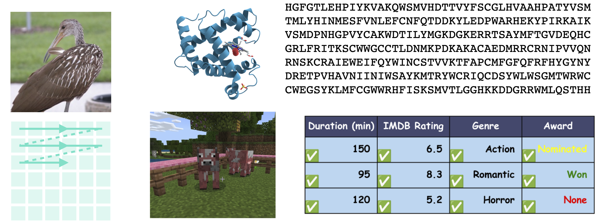

---
hide:
  - navigation
  - toc
---

# [Jiaxin Shi](https://jiaxins.io/){:target="_blank"}
## Masked Discrete Diffusion: Rethinking the Divide Between Autoregression and Diffusion
### Research Scientist at Meta Superintelligence Labs November 18, 2026 (Wed), 10:30 a.m. KST Online (Zoom).

### <b>Guest Lecture at [AIC313/CS378: Introduction to Generative Models](../){:target="_blank"} [Minhyuk Sung](http://mhsung.github.io/){:target="_blank"}, [KAIST](https://www.kaist.ac.kr/){:target="_blank"}, Fall 2026</b>

 
[Zoom Link]({{links.zoom}}){:target="_blank" .md-button}
[Google Calendar Link](https://calendar.google.com/calendar/event?action=TEMPLATE&tmeid=NzEzZ2hjcjlvM2dqZGE0ZXRlaWk4am4yNzQgamhvMGR0bDBwczVjaWl2ZmxqOXJ0NmU0cWtAZw&tmsrc=jho0dtl0ps5ciivflj9rt6e4qk%40group.calendar.google.com){:target="_blank" .md-button}

<!--
[Recording]({{links.guest_rec1}}){:target="_blank" .md-button}
-->

 

{ width=85% }[^1]
{: style="text-align: center;" }

[^1]: Image from [https://jiaxins.io/talks/md4\_ttic.pdf](https://jiaxins.io/talks/md4_ttic.pdf){:target="_blank"}.  

### **Abstract**
Modern generative AI is often viewed through two dominant paradigms: autoregressive models, which underpin much of language modeling, and diffusion models, which have set the standard for high-quality image and video synthesis.
These paradigms are usually treated as fundamentally different: autoregressive models are associated with compression and sequential computation, while diffusion models are associated with perceptual sample quality and parallel generation.
In this talk, I will argue that this divide is less fundamental than it may appear. I will introduce masked diffusion models (MDMs), a class of discrete diffusion models that is theoretically equivalent to random-order autoregressive models.
From this perspective, many empirical differences between autoregression and diffusion, such as parallelism and perceptual quality, arise not from a fundamental distinction between the model classes themselves, but from details of model specification and training techniques.
For example, I will present evidence that the loss reweighting technique from diffusion, when applied to any-order MDM/AR models, can yield perceptual sample quality comparable to strong continuous diffusion models.
Finally, I will talk about some recent advances in using the any-order capability of masked diffusion for parallel drafting in LLMs and de novo enzyme design with new-to-nature chemistry.

### **Bio**
Jiaxin Shi is a Research Scientist at Meta Superintelligence Labs. Previously, he was a Research Scientist at Google DeepMind and a postdoctoral researcher at Stanford University and Microsoft Research. His research spans generative modeling, probabilistic inference, and sequence modeling, with a particular focus on discrete and masked diffusion models. He received his Ph.D. from Tsinghua University and was a recipient of the NeurIPS 2022 Outstanding Paper Award.

 

