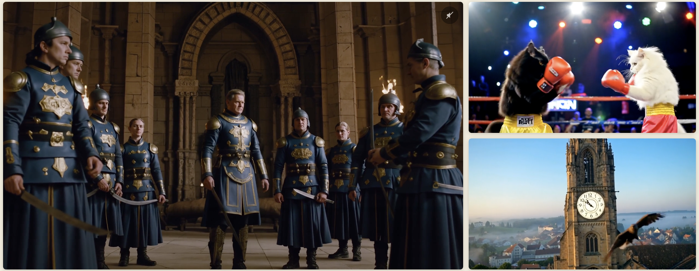

---
hide:
  - navigation
  - toc
---

# [Julius Berner](https://jberner.info/){:target="_blank"}
## Accelerated Diffusion Models
### Research Scientist at NVIDIA December 2, 2026 (Wed), 10:30 a.m. KST Online (Zoom).

### <b>Guest Lecture at [AIC313/CS378: Introduction to Generative Models](../){:target="_blank"} [Minhyuk Sung](http://mhsung.github.io/){:target="_blank"}, [KAIST](https://www.kaist.ac.kr/){:target="_blank"}, Fall 2026</b>

 
[Zoom Link]({{links.zoom}}){:target="_blank" .md-button}
[Google Calendar Link](https://calendar.google.com/calendar/event?action=TEMPLATE&tmeid=MzQxMzE1bnJraDhjODg1cmkydXBjYXFzY24gamhvMGR0bDBwczVjaWl2ZmxqOXJ0NmU0cWtAZw&tmsrc=jho0dtl0ps5ciivflj9rt6e4qk%40group.calendar.google.com){:target="_blank" .md-button}

<!--
[Recording]({{links.guest_rec1}}){:target="_blank" .md-button}
-->

 

{ width=85% }[^1]
{: style="text-align: center;" }

[^1]: Image from [https://research.nvidia.com/labs/genair/pdd/](https://research.nvidia.com/labs/genair/pdd/){:target="_blank"}.  

### **Abstract**
Diffusion and flow models have driven major advances in image, video, and 3D content generation, as well as in a wide range of scientific applications. As the field moves toward interactive applications, including real-time editing, world models, and embodied AI, low-latency generation is becoming essential. This talk will begin with an overview of techniques for accelerating diffusion and flow models, then examine step-distillation methods in detail. We will cover both trajectory-based approaches, such as flow maps and parallel decoding distillation, and distribution-based approaches, such as adversarial distillation and variational score distillation. We will illustrate these methods with practical examples using our open-source FastGen library.

### **Bio**
Julius Berner is a Research Scientist at NVIDIA, where he works on post-training of diffusion and flow models for real-time media generation and interactive world models. His broader research spans generative modeling, deep learning, and scientific applications. Prior to NVIDIA, he was a postdoc at Caltech and completed his PhD sub auspiciis praesidentis at the University of Vienna, alongside research internships at Meta and NVIDIA.

 

